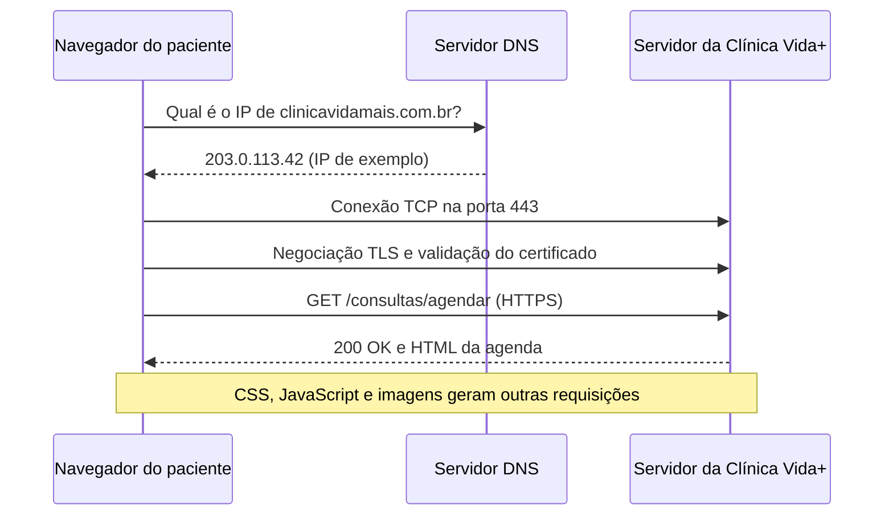

# Arquitetura de uma requisição — Clínica Vida+

## O caminho de uma requisição

O domínio e o IP abaixo são exemplos para explicar a arquitetura, não um serviço publicado da clínica.



O DNS traduz o nome para um endereço IP. Com esse endereço, o navegador estabelece a conexão TCP e negocia o TLS. Depois envia a requisição HTTP protegida pelo TLS e recebe a resposta do servidor.

## Evidência do DNS

Consulta real executada em 15/11/2026, no Windows, para o domínio `github.com`:

```text
> nslookup github.com
Servidor:  UnKnown
Address:  fe80::1298:5fff:fe29:72e0

Não é resposta autoritativa:
Nome:    github.com
Address:  4.228.31.150
```

O servidor DNS consultado apareceu como `UnKnown`, com endereço IPv6 local ao enlace. Ele devolveu `4.228.31.150` para `github.com`. Uma resposta não autoritativa pode vir de um resolvedor/cache; isso não significa que houve erro na resolução.

O teste complementar com `ping` foi executado no Windows, fora do ambiente restrito que bloqueava o driver de IP:

```text
> ping -n 2 github.com
Disparando github.com [4.228.31.150] com 32 bytes de dados:
Resposta de 4.228.31.150: bytes=32 tempo=8ms TTL=116
Resposta de 4.228.31.150: bytes=32 tempo=6ms TTL=116

Estatísticas do Ping para 4.228.31.150:
    Pacotes: Enviados = 2, Recebidos = 2, Perdidos = 0 (0% de perda)
Aproximar um número redondo de vezes em milissegundos:
    Mínimo = 6ms, Máximo = 8ms, Média = 7ms
```

O IP mostrado pelo ping, `4.228.31.150`, é o mesmo devolvido pelo nslookup. Foram recebidas as duas respostas, sem perda de pacotes. A primeira tentativa, dentro do ambiente restrito, havia falhado ao acessar o driver de IP; a execução no Windows permitiu concluir a comparação.

## Evidência do HTTP

As quatro requisições abaixo já estavam anotadas no arquivo original deste repositório, antes desta organização. São o registro anterior da aba Network; não são apresentadas como uma nova captura.

| Método | Recurso solicitado | Status |
|---|---|---|
| GET | `https://github.githubassets.com/assets/21761.ce290bb0a31d9e5a.module.css` | 200 |
| GET | `https://github.com/tiagoboccato0/uninove-2026-2-clinica-vida/_sidebar` | 304 |
| GET | `https://github.githubassets.com/assets/chunk-75241-f2a646735643f799.js` | 200 |
| GET | `https://github.com/in-product-messaging/organization-new-tasks-indicator.json` | 304 |

`200` indica sucesso. `304` informa que o recurso não mudou e que o navegador pode reutilizar sua cópia em cache. Há recursos não HTML na tabela: CSS e JavaScript. O registro anterior também indicava erro 404 no endereço `https://github.com/tiagoboccato0/uninove-2026-2-clinica-vida/nada`.

### Verificação complementar de cabeçalhos e 404

Em 15/11/2026 foram feitas requisições HTTP reais, por script, aos materiais públicos da disciplina. O registro completo está em [evidencias/http-complementar.json](evidencias/http-complementar.json). Essa verificação complementa o registro anterior e não substitui uma captura nova do DevTools.

| Método | Recurso solicitado | Status | Content-Type da resposta |
|---|---|---|---|
| GET | `https://josercf.github.io/uninove-2026-2-desenvolvimento-web/aulas-1sem/aulas/aula02.html` | 200 | `text/html; charset=utf-8` |
| GET | `https://cdn.jsdelivr.net/npm/reveal.js@5.1.0/dist/reveal.css` | 200 | `text/css; charset=utf-8` |
| GET | `https://cdn.jsdelivr.net/npm/reveal.js@5.1.0/dist/theme/white.css` | 200 | `text/css; charset=utf-8` |
| GET | `https://cdn.jsdelivr.net/npm/reveal.js@5.1.0/plugin/highlight/monokai.css` | 200 | `text/css; charset=utf-8` |
| GET | `https://josercf.github.io/uninove-2026-2-desenvolvimento-web/pagina-que-nao-existe-tiago` | 404 | `text/html; charset=utf-8` |

Na requisição da página, `Host` é `josercf.github.io` e `User-Agent` foi `ClinicaVida-Laboratorio/1.0`. `Host` identifica o servidor de destino; `User-Agent` identifica o cliente que enviou a requisição. `Content-Type` vem da resposta e informa o tipo de conteúdo devolvido. Em HTTP/2, o destino pode aparecer como `:authority` em vez de `Host`.

## Por que o formulário precisa de HTTPS

O formulário de agendamento pode transmitir nome, CPF e dados de contato do paciente.
O HTTPS usa TLS para criptografar esses dados durante o transporte.
Isso ajuda a evitar que terceiros leiam ou alterem o conteúdo no caminho.
O certificado também permite verificar a identidade do servidor da clínica.
Mesmo com HTTPS, a aplicação ainda precisa controlar o acesso e proteger os dados armazenados.
